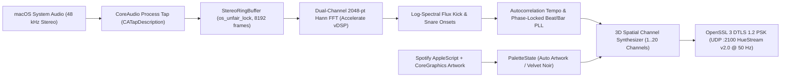

# Architecture: 48 kHz CoreAudio `vDSP` + 50 Hz DTLS 1.2 `HueStream v2.0`

`hue-dsp` bridges macOS system audio (`CoreAudio` `CATapDescription`), Apple `Accelerate`/`vDSP` spectral analysis, and Philips Hue Entertainment streaming (`DTLS 1.2` `PSK-AES128-GCM-SHA256` over UDP port `2100`) into a single zero-dependency CLI (`hue-dsp` / `hue-query`) and native C11/Swift 6 real-time daemon (`hue-dsp-stream`).

---

## 1. Real-Time Audio Capture & Phase-Invariant Spectral Pipeline (`src/hue_dsp/native/hue_dsp_stream.swift`)

1. **Zero-Driver System Audio Tap (`CATapDescription`)**:
   - Uses macOS 14.2+ `AudioHardwareCreateProcessTap` (`CATapDescription(stereoGlobalTapButExcludeProcesses: [])`) attached to a private aggregate device (`HueLiveDSPTap`) with drift compensation enabled. No third-party virtual audio kext or loopback driver is required.
2. **Bounds-Checked `StereoRingBuffer`**:
   - Synchronizes real-time CoreAudio IOProc writes and 50 Hz DSP reads with an `os_unfair_lock` over an 8192-frame circular buffer.
   - Bounds both planar (`abl.count >= 2`) and interleaved (`abl.count == 1`) `AudioBufferList` packets strictly by `Int(mDataByteSize) / MemoryLayout<Float>.size` and channel stride.
3. **Phase-Invariant Dual-Channel 2048-Point `vDSP` FFT**:
   - At 48 kHz, a 2048-sample Hann-windowed `vDSP_fft_zrip` provides `23.44 Hz` frequency resolution per bin (`42.7 ms` window updated every `20 ms`).
   - Rather than summing $(L + R)/2$ in the time domain—which suffers destructive cancellation on wide-panned stereo synths or $180^\circ$ out-of-phase signals—`computeStereoSpectrum` executes two separate real FFTs on $L$ and $R$ and combines their power spectra:
     $$M[k] = \sqrt{\frac{|X_L[k]|^2 + |X_R[k]|^2}{2}}, \quad \text{RMS}_{\text{stereo}} = \sqrt{\frac{\text{RMS}_L^2 + \text{RMS}_R^2}{2}}$$
4. **4-Band Contrast-Expanded Envelopes & Parseval Power Centroid**:
   - Extracts Sub-Bass (`40–120 Hz`), Bass Groove (`120–360 Hz`), Vocal/Harmonic Mid (`360–2800 Hz`, plus independent Left/Right stereo mid envelopes), and Brilliance/Air (`2.8–11 kHz`) through fast-attack (`16 ms`) / musical-decay (`110 ms`) adaptive floor-to-peak trackers (`BandTracker`).
   - Computes the power-weighted spectral centroid:
     $$f_{\text{centroid}} = \frac{\sum_{k=2}^{k_{\max}} k \cdot \Delta f \cdot M[k]^2}{\sum_{k=2}^{k_{\max}} M[k]^2}$$

---

## 2. Tempo-Locked Beat/Bar PLL & 3D Spatial Synthesis

1. **Half-Wave Rectified Log-Spectral Flux Onsets**:
   - Computes log-compressed spectral flux $J_{\text{flux}}(n) = \sum_k \max(0, \ln(1 + \gamma M_n[k]) - \ln(1 + \gamma M_{n-1}[k]))$ across the low kick band (`40–145 Hz`, with a `160 ms` refractory gate) and high snare/hi-hat band (`1.1–7.5 kHz`).
2. **Autocorrelation Tempo Estimator & Phase-Locked Oscillators**:
   - Every `0.5 s` (`25` frames), evaluates the normalized autocorrelation of the `6.0 s` (`300`-frame) low-frequency onset history across lags `18..46` (`65–165 BPM`), weighted by a perceptual log-Gaussian tempo prior centered at `108 BPM` with parabolic 3-point lag interpolation.
   - Advances continuous beat phase $\phi_{\text{beat}} \in [0, 1)$ and 4-beat bar phase $\phi_{\text{bar}} \in [0, 4)$, nudging phase error toward `0` on verified kick transients:
     $$\phi_{\text{beat}} \leftarrow \operatorname{mod}_1\left(\phi_{\text{beat}} + \frac{\text{BPM}}{60 \cdot f_s} + \kappa \cdot e_\phi\right)$$
3. **3D Spatial Channel Roles (`1..20` Entertainment Channels)**:
   - Queries `/clip/v2/resource/entertainment_configuration` and maps each channel's 3D `(x, y, z)` coordinates into 5 musical roles:
     - **Center Kick (`role = .centerKick`)**: Kick transient + downbeat pulse + sub-bass body.
     - **Front-Low Bass (`role = .frontBass`)**: Phase-delayed (`+0.22` beat) radial bass wavefront travelling outward from center.
     - **Left Stage (`role = .leftStage`)**: Left stereo mid/vocal envelope + odd-beat harmonic bar sway.
     - **Right Stage (`role = .rightStage`)**: Right stereo mid/lead envelope + even-beat harmonic bar sway + centroid hue shift.
     - **Rear Snare/Sparkle (`role = .rearSnare`)**: Snare backbeat, hi-hat shimmer, and off-beat (`+0.50` beat) syncopation.

---

## 3. C11 DTLS 1.2 `HueStream v2.0` Transport & Verified Lifecycle Barriers

1. **OpenSSL 3 DTLS 1.2 PSK Transport (`src/hue_dsp/native/dtls_hue.c`)**:
   - Establishes a `DTLSv1.2` session over UDP port `2100` using cipher `PSK-AES128-GCM-SHA256`, authenticating with `hue-application-id` and the 16-byte hex `clientkey`.
   - Formats 16-bit gamma-2.1 RGB channels into big-endian `HueStream v2.0` datagrams (`52 + 7 * N` bytes for $N \in [1, 20]$ channels).
   - Uses a C11 lock-free `atomic_int` (`_Static_assert(ATOMIC_INT_LOCK_FREE == 2)`) for async-signal-safe `SIGTERM`/`SIGINT` handling without data races.
2. **Confirmed Process-Exit & CLIP v2 `status == "inactive"` Teardown Barrier (`src/hue_dsp/cli.py`)**:
   - `stop_existing_daemon()` sends `SIGTERM`, escalates to `SIGKILL` if unresponsive, blocks until `_pid_alive(pid)` is false, and verifies via `GET /clip/v2/resource/entertainment_configuration/<id>` that the target configuration reports `status == "inactive"` before unlinking `PID_FILE` or issuing V1 REST light commands.
